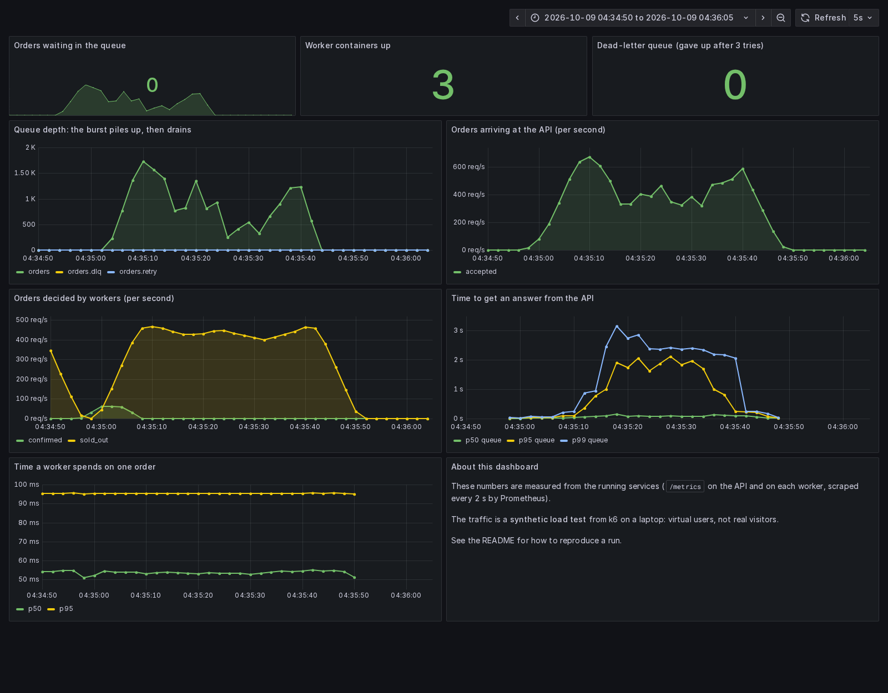

# FlashQueue

A limited-stock "flash sale" backend that stays correct when thousands of buyers arrive at once.
The API answers immediately and puts each order on a **RabbitMQ** queue; a pool of workers decides
the orders at a pace they can sustain, with **Redis** holding the stock and the order state.

```
client ──► api ──► Redis   idempotency key, order state, stock
             │
             └──► RabbitMQ  orders ──► worker(s) ──► Redis   (decide: confirmed / sold out)
                              │  failed once ──► orders.retry (waits 3 s, flows back into orders)
                              └  failed 3 times ─► orders.dlq   (parked for a human)
```

## What it shows

- **Absorbing a burst.** `POST /orders` stores the order, publishes it with a broker confirm, and returns
  `202` straight away. The work happens afterwards, so a spike becomes a backlog instead of an outage.
- **Backpressure.** Workers take at most `2 x WORKERS` unacknowledged orders at a time. If the backlog
  passes `MAX_QUEUE` the API answers `503` with `Retry-After` instead of promising work it cannot do.
- **Correct under at-least-once delivery.** RabbitMQ can deliver a message twice (a worker dies after
  working but before acknowledging). The outcome is decided by one atomic Lua script in Redis, so a second
  delivery returns the first result and never takes stock twice. No overselling, ever.
- **Idempotent requests.** Send an `Idempotency-Key`; a retry or double click returns the original order.
- **Retry and dead-letter.** A failed attempt waits in `orders.retry` (a TTL queue that dead-letters back
  into `orders`, so no plugin is needed) and after 3 attempts the order lands in `orders.dlq`.
- **Graceful shutdown.** A worker stops consuming, finishes what it holds, then exits.
- **Metrics.** Prometheus counters, histograms and queue-depth gauges on `/metrics` (API) and `:9102` (worker).

## Run it

Needs Docker. Only these ports are published, so it will not clash with a RabbitMQ or Redis you already
run on 5672 / 6379: **8081** (API), **15673** (RabbitMQ UI, `guest` / `guest`), **3001** (Grafana, no login),
**9091** (Prometheus).

```bash
docker compose up -d --build
docker compose up -d --scale worker=3        # more workers

curl -X POST localhost:8081/orders -H 'Idempotency-Key: abc-1' -d '{"user":"me"}'
curl localhost:8081/stats
```

| Endpoint | |
| --- | --- |
| `POST /orders` | queue an order, `202` immediately (needs `Idempotency-Key`) |
| `POST /orders/sync` | the same work **without** a queue, as a baseline to compare against |
| `GET /orders/{id}` | one order's status: `queued`, `confirmed`, `sold_out`, `failed` |
| `GET /stats` | stock, outcomes, queue sizes, connected workers |
| `POST /admin/reset?stock=N` | clean slate for demos and tests (needs `X-Admin-Key`; development only) |

Settings (environment variables in `docker-compose.yml`): `WORKERS` (default 8), `WORK_MS` (how long one
order takes, default 50), `FAIL_PCT` (percent of attempts that fail on purpose), `MAX_QUEUE`, `STOCK_INIT`.

## Check it

`cmd/check` fires a burst, waits for the system to settle, and verifies the rules that must hold:
nothing lost or stuck, never oversold, stock left matches what was confirmed, a repeated key never makes a
second order. It exits non-zero if any rule fails, and it prints what it measured.

```bash
go run ./cmd/check -n 3000 -c 200 -stock 100            # through the queue
go run ./cmd/check -n 3000 -c 200 -stock 100 -sync      # no queue, for comparison
FAIL_PCT=40 docker compose up -d worker                 # then run it again: retries and the DLQ kick in
```

## Watch it, and load it

Prometheus scrapes `/metrics` from the API and from every worker every 2 seconds (new workers from
`--scale` are found automatically), and Grafana draws a ready-made dashboard at **http://localhost:3001**:
queue depth, orders arriving, orders decided, time to get an answer, time a worker spends on one order,
workers up, and the dead-letter queue.

The numbers on the dashboard come from the services themselves. The traffic comes from **k6**, which plays
a crowd of virtual buyers. It is a synthetic load test, not real visitors.

```bash
docker compose up -d --scale worker=3
docker compose run --rm k6                  # ramp to 200 virtual users, hold 30 s, leave
VUS=400 HOLD=60s docker compose run --rm k6
```

Open the dashboard while it runs: the queue climbs, the workers chew through it, and it drains. The k6
run fails (non-zero exit) if the API's p95 passes 1 s or more than 1% of requests error.

## What I measured

**k6 load test**: 200 virtual users ramping up over 10 s, holding 30 s, then leaving, each buying with a short
random pause; 500 units for sale, 3 worker containers. Everything ran on one Windows laptop under Docker
Desktop, **with k6, Prometheus, Grafana, RabbitMQ, Redis, the API and the workers all sharing its CPU**, so
the absolute numbers say little about real hardware.

| | |
| --- | --- |
| orders sent and accepted | 18,693 in 45 s (about 410 per second on average) |
| failed or rejected requests | 0 (0.00%) |
| time to get an answer, k6 | median 119 ms, p95 654 ms, slowest 3.6 s |
| peak arrivals / peak decided (Grafana) | 613 / 465 orders per second |
| peak backlog | about 2,900 orders waiting |
| after the burst | queue empty a few seconds later; 500 confirmed, 18,193 sold out, never oversold |



*One run of the test above (200 virtual users, 3 workers, one laptop; the times are UTC). k6 reported 19,581
orders at about 430 per second, p95 991 ms, 0% failed. The dashboard's p95 line (about 2 s here) is a
Prometheus estimate from coarse histogram buckets, and at the busiest moments it reads higher than k6's own
whole-run figure.*

Reading it honestly:

- The workers topped out at about 465 orders per second, which is what the arithmetic predicts
  (3 containers x 8 slots / 50 ms = 480). The backlog is what absorbed the difference.
- **Latency varies a lot from run to run on this laptop.** In the run above, Grafana's p95 estimate at the
  busiest moments went well above 1 s while k6 reported 654 ms for the whole run; in another run of the
  same test the dashboard showed a p95 of about 0.5 s and a p99 under 1 s at the same arrival rate. k6's own
  whole-run p95 for three runs of the identical test was 316 ms, 654 ms and 991 ms. Part of
  the gap is method: k6's figure covers the quiet ramp-up too, and Prometheus estimates percentiles from
  coarse histogram buckets (once its estimate even exceeded k6's slowest request, 3.6 s, so it can
  overstate). The rest is noise from everything sharing one CPU. Read the latency numbers as a range, not a
  single value. I have not tuned the API or profiled where its time goes, so I will not guess at a cause.

**Queue versus no queue** (`cmd/check`): 3000 orders from 200 concurrent clients for 100 units, one worker container (8 slots x 50 ms, so about 160
orders/s of capacity). Docker Desktop on a Windows laptop, the load generator running in a container, no
tuning, one run each. **Treat these as shape, not as a benchmark.**

| | through the queue | no queue (`/orders/sync`) |
| --- | --- | --- |
| requests answered per second | 674 | 156 |
| time to get an answer (p50 / p95) | 270 ms / 399 ms | 1.28 s / 1.29 s |
| burst fully answered after | 4.5 s | 19.3 s |
| every order decided after | about 19.6 s | 19.3 s |
| overselling, lost orders, duplicates | none | none |

The queue does **not** make the work itself faster: capacity is the same, so everything is decided at
about the same time. What it changes is how long clients wait for an answer, and what happens when demand
exceeds capacity (a backlog that drains, instead of requests piling up and timing out).

More workers drain the backlog faster: with 3 worker containers (24 slots) the same burst cleared
**2.8 s** after it ended, against 15 s with one. With `FAIL_PCT=40`, 500 orders for 100 units finished with
23 orders in the dead-letter queue (matching RabbitMQ's own count) and every rule still holding.

## Limits, on purpose

- **Single node** RabbitMQ and Redis, no clustering or persistence tuning.
- **Redis is the only store.** Orders are not written to a durable relational database; a real shop would
  add one, written by the worker.
- **A lost broker connection exits the process** and relies on the container restart policy to reconnect,
  rather than reconnecting in place.
- The 50 ms of "work" is a sleep standing in for payment, email and so on.
- `MAX_QUEUE` backpressure is implemented but not exercised by the runs above.
